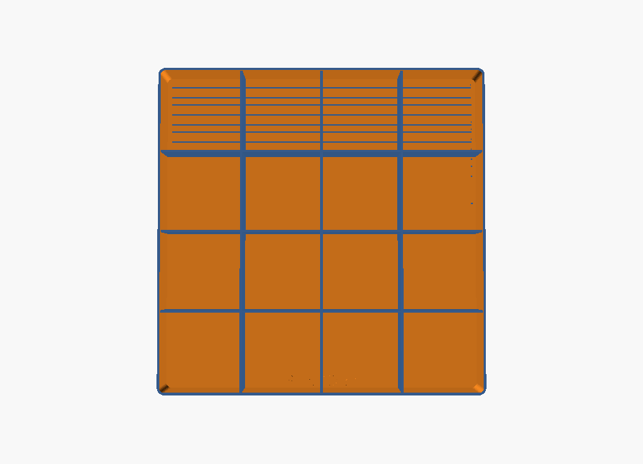
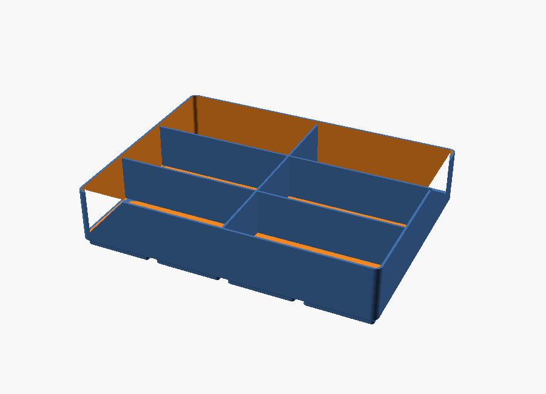
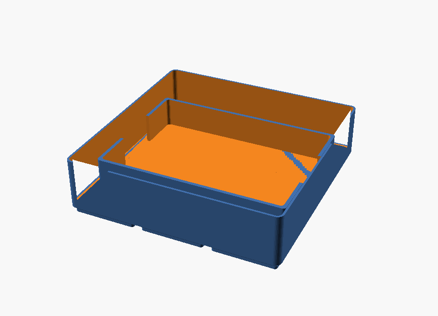
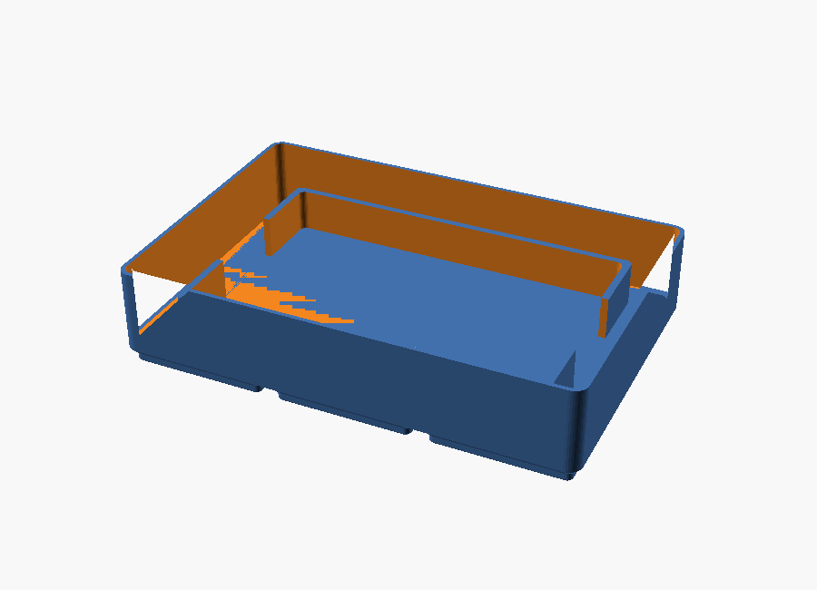

# Models catalog

Generated by `tools/models.py` from `catalog/models.yaml` — **do not edit by hand**.

**6 models** · 4 verified · 0 printed · 2 draft · 0 physical prints so far

| model | kind | cells | height | size (mm) | weight | status | prints | file |
|---|---|---|---|---|---|---|---|---|
| **Fit test tray 3x2x3U** | gridfinity_tray | 3x2 | 3U | 125.5 x 83.5 x 21 | 52 g | verified | 0 | [fit_test_3x2x3.scad](scad/examples/fit_test_3x2x3.scad) |
| **Sensor tray 4x4 (16 small compartments)** | gridfinity_tray | 4x4 | 5U | 167.5 x 167.5 x 35 | 199 g | verified | 0 | [sensor_tray.scad](scad/examples/sensor_tray.scad) |
| **Sensor tray 4x3 (6 large compartments)** | gridfinity_tray | 4x3 | 5U | 167.5 x 125.5 x 35 | 134 g | verified | 0 | [sensor_tray.scad](scad/examples/sensor_tray.scad) |
| **Brain holder 3x3 (1st gen)** | holder | 3x3 | 5U | 125.5 x 125.5 x 35 | 96 g | verified | 0 | [holder.scad](scad/examples/holder.scad) |
| **Battery holder 3x2 (prototype)** | holder | 3x2 | 4U | 125.5 x 83.5 x 28 | 61 g | draft | 0 | [holder.scad](scad/examples/holder.scad) |
| **Gridfinity baseplate 6x4** | baseplate | 6x4 | - | 252 x 168 x ? | - | draft | 0 | - |

## Fit test tray 3x2x3U

- **id:** `fit-test-3x2x3` · **kind:** gridfinity_tray · **status:** verified · **prints:** 0
- **parts covered:** `beam-1x8` x2
- **pocket:** divider x1 → `beam-1x8`
- **source:** [`scad/examples/fit_test_3x2x3.scad`](scad/examples/fit_test_3x2x3.scad)
- Reference tray and Gridfinity fit test. One divider makes two channels for 1x8 beams, with engraved labels. Print this first to confirm the 42 mm grid on your printer.

## Sensor tray 4x4 (16 small compartments)

- **id:** `sensor-tray-small-4x4` · **kind:** gridfinity_tray · **status:** verified · **prints:** 0
- **pocket:** divider_grid x16 → -
- **source:** [`scad/examples/sensor_tray.scad`](scad/examples/sensor_tray.scad)
- 16 compartments of one grid cell each (~40 x 40 mm) — for small sensors and loose parts. Print file: print/sensor_tray_4x4_16p.stl. Build: scad.py build scad/examples/sensor_tray.scad --name sensor_tray_4x4_16p --set NX=4 --set NY=4 --set H_U=5 --set PX=4 --set PY=4 --set DIV_WALL=2. Two of these hold 32 parts, i.e. the ~30 small sensors.

## Sensor tray 4x3 (6 large compartments)

- **id:** `sensor-tray-large-4x3` · **kind:** gridfinity_tray · **status:** verified · **prints:** 0
- **pocket:** divider_grid x6 → -
- **source:** [`scad/examples/sensor_tray.scad`](scad/examples/sensor_tray.scad)
- 6 compartments of two grid cells each (~82 x 40 mm) — for the bigger sensors. Print file: print/sensor_tray_4x3_6p.stl. Build: scad.py build scad/examples/sensor_tray.scad --name sensor_tray_4x3_6p --set NX=4 --set NY=3 --set H_U=5 --set PX=2 --set PY=3 --set DIV_WALL=2.

## Brain holder 3x3 (1st gen)

- **id:** `holder-brain-1g` · **kind:** holder · **status:** verified · **prints:** 0
- **parts covered:** `brain-1g` x1
- **pocket:** frame x1 → `brain-1g`
- **source:** [`scad/examples/holder.scad`](scad/examples/holder.scad)
- Fitted frame for the 1st gen Robot Brain (official size 106.7 x 76.2 x 41.7 mm with battery). Frame 18 mm high with a 30 mm grip gap. Build: scad.py build scad/examples/holder.scad --name holder_brain_1g --set NX=3 --set NY=3 --set H_U=5 --set FRAME_H=18 --set FINGER=30.

## Battery holder 3x2 (prototype)

- **id:** `holder-battery-3x2` · **kind:** holder · **status:** draft · **prints:** 0
- **parts covered:** `battery-2g` x1
- **pocket:** frame x1 → `battery-2g`
- **source:** [`scad/examples/holder.scad`](scad/examples/holder.scad)
- Prototype only — the item size (95 x 60 x 25 mm) is a PLACEHOLDER until the battery is measured. Same file handles the controller and the 2nd gen brain.

## Gridfinity baseplate 6x4

- **id:** `gridfinity-baseplate-6x4` · **kind:** baseplate · **status:** draft · **prints:** 0
- Planned reference baseplate so the trays can be used in a drawer. Geometry to be generated from gf.scad.
