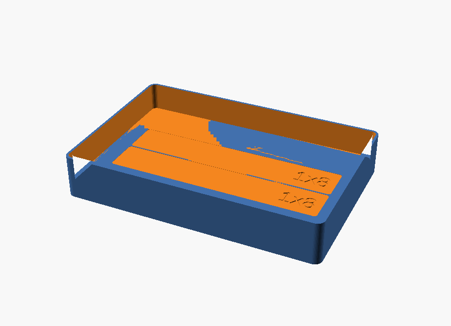

# Models catalog

Generated by `tools/models.py` from `catalog/models.yaml` — **do not edit by hand**.

**2 models** · 1 verified · 0 printed · 1 draft · 0 physical prints so far

| model | kind | cells | height | size (mm) | weight | status | prints | file |
|---|---|---|---|---|---|---|---|---|
| **Fit test tray 3x2x3U** | gridfinity_tray | 3x2 | 3U | 125.5 x 83.5 x 21 | 101 g | verified | 0 | [fit_test_3x2x3.scad](scad/examples/fit_test_3x2x3.scad) |
| **Gridfinity baseplate 6x4** | baseplate | 6x4 | - | 252 x 168 x ? | - | draft | 0 | - |

## Fit test tray 3x2x3U

- **id:** `fit-test-3x2x3` · **kind:** gridfinity_tray · **status:** verified · **prints:** 0
- **parts covered:** `beam-1x8` x2
- **pocket:** channel x2 → `beam-1x8`
- **source:** [`scad/examples/fit_test_3x2x3.scad`](scad/examples/fit_test_3x2x3.scad)
- Reference tray and Gridfinity fit test. Two flat channels for 1x8 beams with engraved labels. Print this first to confirm the 42 mm grid on your printer.

## Gridfinity baseplate 6x4

- **id:** `gridfinity-baseplate-6x4` · **kind:** baseplate · **status:** draft · **prints:** 0
- Planned reference baseplate so the trays can be used in a drawer. Geometry to be generated from gf.scad.
